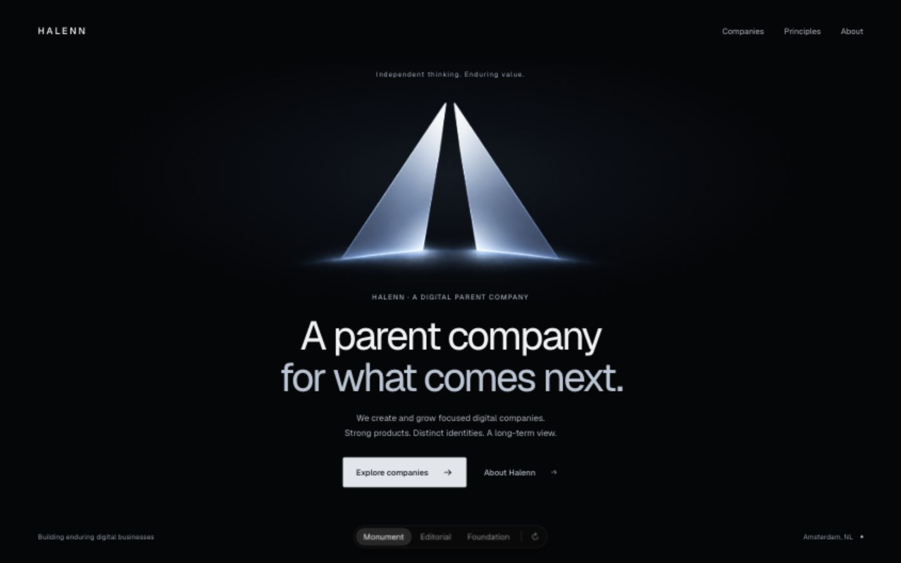
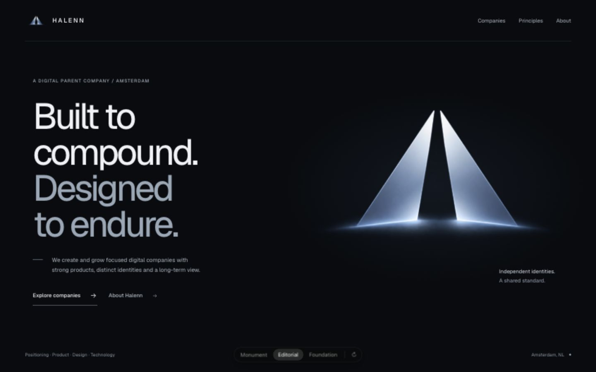
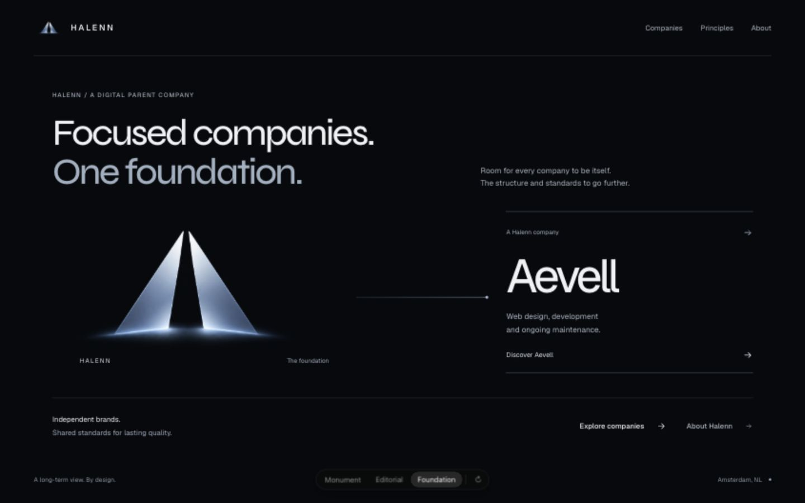
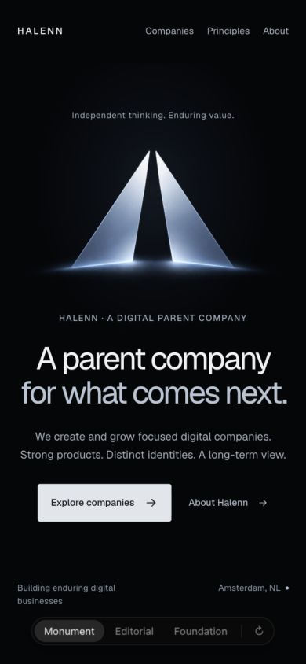
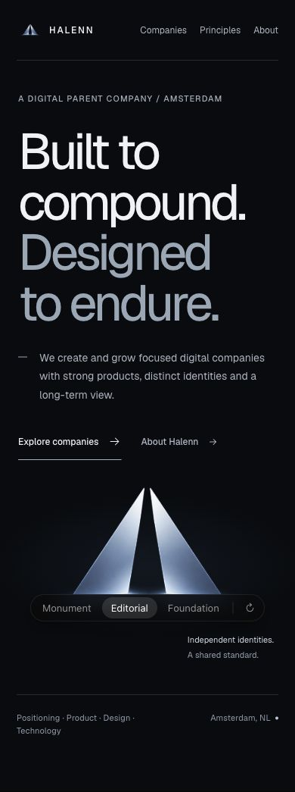
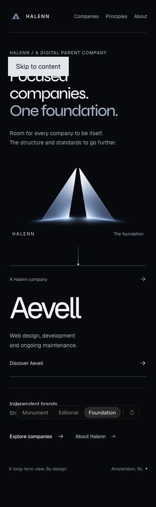

# Halenn hero explorations

Local branch: `codex/halenn-hero-explorations` · audited baseline: `0f4c17251b0502e13ffbf44e106a7937ce537945` · 23 October 2026.

## Open the comparison

```sh
npm ci --ignore-scripts
npm run dev -- --hostname 127.0.0.1 --port 3010
```

Open [the picker](http://127.0.0.1:3010/prototypes/hero?v=1). Click a direction, use **1–3** or **← / →**, and use **R** or **↻** to replay. Selection survives reload through `?v=1–3`. Each switch mounts one full-size direction and returns to the top. Form fields, editable content, and modified shortcuts are excluded from picker shortcuts.

The route returns **404 outside development** and carries `noindex, nofollow`. It shares the existing root font resources, but all prototype components and visual styles are separate. Links into the preserved homepage deliberately use document navigation to isolate its legacy global smooth scrolling and interactive lifecycle. The existing homepage, global CSS, layout, logo modules, version API, deployment-update component, and existing public artwork remain unchanged. Nothing has been pushed, merged, or deployed.

## Directions

| # | Variant | Axis | When it is right | Cost |
| --- | --- | --- | --- | --- |
| 1 | [Monument](http://127.0.0.1:3010/prototypes/hero?v=1) | Artwork-led, centered, one quiet light entrance | Establishing the metallic mark as Halenn's main visual signature | More vertical space; a familiar centered reading order |
| 2 | [Editorial](http://127.0.0.1:3010/prototypes/hero?v=2) | Type-led, asymmetric, short text entrances | Giving the parent company a confident editorial voice | More scroll on mobile; the large artwork follows the copy |
| 3 | [Foundation](http://127.0.0.1:3010/prototypes/hero?v=3) | Company-led, horizontal relationship that becomes vertical | Explaining Halenn's relationship with Aevell immediately | Densest direction; the longest mobile composition |

The factual positioning and navigation come from the existing site. There are no invented companies or metrics. The cursor flashlight is replaced with static environmental light. The logo never tilts, shimmers, moves, changes surface, or acts as a lighting button.

### Desktop captures

| Monument | Editorial | Foundation |
| --- | --- | --- |
|  |  |  |

### Mobile captures

| Monument | Editorial | Foundation |
| --- | --- | --- |
|  |  |  |

## Audit before implementation

The connected GitHub repository and live deployment were inspected before edits. `/api/version` identified the same audited commit. The current workspace was an empty, unrelated Aevell repository; a separate Halenn checkout was created without changing it.

| Before | After in this exploration | Why |
| --- | --- | --- |
| `app/halennLogo.ts:1` embeds a 192×96 WebP; direct decoding and the live hero both show block/color artifacts. | All prototype logo instances reference the supplied original PNG through an unoptimized image component. | Avoid enlarging damaged artwork or re-creating the mark. |
| Several competing sources exist: two data-URI modules, a raster-in-SVG wrapper, and three WebPs. The cinematic WebP contains 7,512 bytes while its RIFF header declares 21,364. | One verified original source for all prototypes. Existing assets remain untouched for comparison. | A name such as “approved” cannot establish file integrity. |
| `app/globals.css:241` overlays another brightened, masked copy of the mark; multiple blurred layers breathe indefinitely. | No filters or masks on the artwork. Monument uses one bounded opacity entrance on the surrounding light. | Preserve the approved material and remove unnecessary continuous work. |
| `app/page.tsx:1` makes the whole landing page a client component. `:81` tracks every pointer movement even when the light is off. | Server-rendered variant markup is passed into a small client picker. No pointer tracking or motion dependency. | Keep static content independent of decorative behavior. |
| `app/page.tsx:150` and `:160` lock flashlight transitions for 1,550/1,250ms. Touch CSS hides the visuals while the control remains active. | No flashlight state machine. Picker selection is immediate. | Remove a delayed interaction with no meaningful touch result. |
| Reduced-motion CSS shortens animations but does not shorten those JavaScript timers. | Reduced motion removes the text transform and environmental entrance; content remains fully visible. | Visual and interaction state no longer drift. |
| `app/globals.css:1038` starts revealed content at opacity zero. | Prototype content is server-rendered and visible without JavaScript. | Avoid invisible content on script/observer failure. |
| `app/DeploymentUpdateGate.tsx:149` blocks the page with a modal lacking focus management and dismissal. | No deployment messaging can appear on the development-only route; the inherited component is left intact on the reference homepage. | Avoid editing production behavior before a direction is selected. |
| Small, tracked Michroma labels and three font families compete with the hero. | Geist-led Monument/Editorial; Syne gives Foundation a different typographic voice. No additional fonts. | Explore hierarchy without adding font downloads. |
| The 390px reference hero is about 909px tall, with a four-line headline. Principles disappears from mobile navigation; its sibling links are only 18px high. | All destinations remain present with 44px-high targets. Each design has its own mobile composition. | Preserve function while exploring layout. |
| Hero footer text is approximately 3.41:1 against the base background. Hover animates padding/width and includes transitions up to 900ms. | Higher-contrast text, fine-pointer hover gating, short explicit transitions. | Improve legibility and avoid needless layout work. |
| No dependency lockfile or repeatable verification command. | npm lockfile, type-check script, and eight HTTP/integrity checks. | Make the checkout and basic verification reproducible. |
| Baseline Next 16.4.0 compiled but the build stopped on a critical advisory. | Next and eslint-config-next patched to 16.4.3; production build passes. | Address the concrete framework issue on this isolated branch. |

**Baseline checks:** lint passed with two existing image warnings; TypeScript passed. The initial build compiled/prerendered and then exited with the framework security advisory. The patched build succeeds; `npm audit --omit=dev` reports zero runtime vulnerabilities. Five high npm audit findings remain in the development-only ESLint → fast-glob → micromatch → braces dependency chain. npm's suggested forced remediation would downgrade the lint framework; it was not applied.

The linked Aevell domain currently resolves to a GoDaddy parked page. The owner confirmed that `aevell.com` is their domain, so the inherited target is deliberately retained.

## Artwork provenance

Original supplied file: `ChatGPT Image Oct 8, 2026, 03_21_35 PM.png`.

- Exact copy: `public/prototypes/halenn-original.png`.
- Dimensions: **1774 × 887**; PNG with alpha; **807,851 bytes**.
- SHA-256: `8d0753ae6b55e250a7880408943cbfb80e9a37d041b1274900140d68d9f94c97`.
- Both the copied file and HTTP-served bytes match this checksum.
- No lossy optimization, cropping, masking, recoloring, generation, or geometry edits. Intrinsic dimensions reserve layout space. Header and hero instances share one asset URL.

## Verification

```sh
npm run lint
npm run typecheck
npm run build
npm run start -- --hostname 127.0.0.1 --port 3011
# With the dev server also running:
HALENN_PRODUCTION_URL=http://127.0.0.1:3011 npm run verify:hero
```

- **Eight automated tests pass:** each direction's server-rendered selection, malformed/out-of-range/repeated query fallback, one real H1, noindex metadata, navigation destinations, original image bytes/dimensions, production 404s, homepage and version endpoint availability.
- **Browser:** every direction inspected at 1440×900 and 390×844; additional 320×740, 768×1024, and 1280×720 checks. No horizontal overflow; one active picker item and one H1. Raw layout evidence is in `browser-checks.json`.
- **Interactions:** picker clicks, number keys, arrow wraparound, replay, reload persistence, internal navigation, skip-link focus transfer, and Aevell's new-tab link. All internal navigation targets resolve to the preserved homepage sections.
- **Accessibility:** visible keyboard focus, 44px product navigation/actions, semantic landmarks, decorative logo alt handling, contrast (minimum measured static text ratio 6.73:1), narrow-viewport reflow, and actual 200% Chrome zoom for all three variants without horizontal overflow. Picker chrome is the skill's prescribed 28px control height. It fits at 320px.
- **No JavaScript:** verified in Chrome with DevTools' JavaScript blocking enabled for all three direct URLs; all headings and images remain visible. The picker requires JavaScript, while the navigation remains ordinary links.
- **Reduced motion:** Chrome's media emulation verified `animation-name: none`, `transform: none`, and `opacity: 1` on Editorial's animated text. Browser settings were restored afterward.
- **Console:** no application warnings/errors captured during the final normal browser flow. The two existing source lint warnings remain confined to production image components. An editing-only Fast Refresh hook warning was cleared with a fresh document. The legacy smooth-scroll router warning is avoided by using document links for reference destinations.
- **Preservation:** existing tracked application/public files have no diff against the audited commit. Shared configuration changes are the security patch, npm lock, verification scripts, Next's generated dev-types include, and hiding the local development badge.

### Performance interpretation

These are development-only prototypes, not production benchmarks. They use server markup and one client harness; no global pointer listener, continuous animation, blur animation, or added motion library. Artwork dimensions reserve the correct aspect ratio and all image instances loaded at their original resolution. The exact original PNG is intentionally 807KB rather than a lossy substitute.

The original page's large filtered layers and always-on pointer work are code-confirmed risks, not measured frame-rate failures. Chrome's page-load trace stalled waiting for a load event and was stopped; no LCP or frame-rate score is claimed. A physical-device GPU/gesture profile and production Core Web Vitals for the eventual selected implementation remain future checks. Actual 200% browser zoom was checked in Chrome and restored afterward. Narrow reflow was verified down to 320 CSS pixels.

**Motion review: approve these isolated prototypes; block reuse of the current production effects unchanged.** The prototypes use the existing scoped easing token with Emil's `cubic-bezier(0.23, 1, 0.32, 1)`, 160ms interaction transitions, 240ms text entry with 40ms stagger, and one 650ms atmospheric entrance. Only the skill-prescribed small picker highlight animates width. No mark is transformed. Integration and the rest of the site wait for the owner's choice.

## Skill sources

- [Design engineering](https://github.com/emilkowalski/skills/blob/main/skills/emil-design-eng/SKILL.md)
- [Prototype and picker contract](https://github.com/emilkowalski/skills/blob/main/skills/prototype/SKILL.md)
- [Animation construction](https://github.com/emilkowalski/skills/blob/main/skills/animate/SKILL.md)
- [Animation review](https://github.com/emilkowalski/skills/blob/main/skills/review-animations/SKILL.md)
- [Animation performance](https://github.com/emilkowalski/skills/blob/main/skills/animation-performance/SKILL.md)
