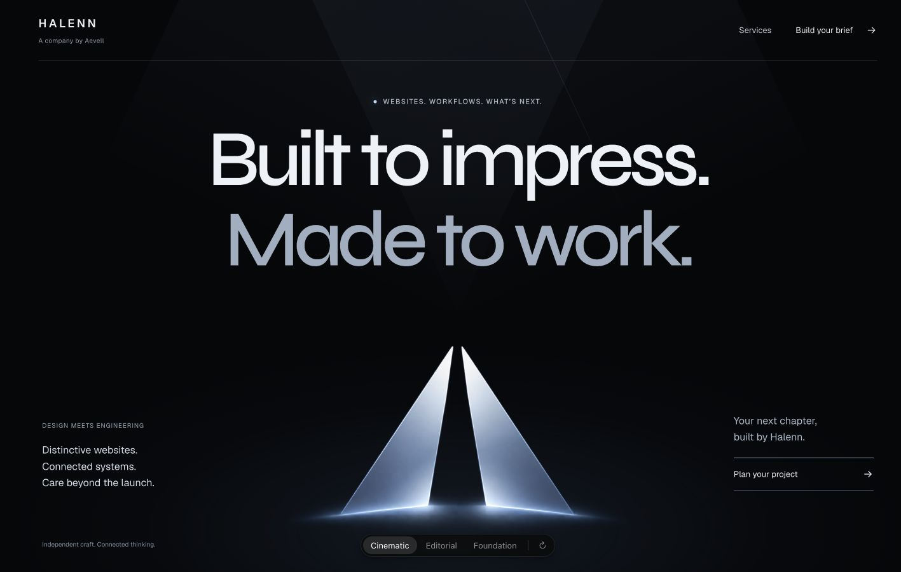
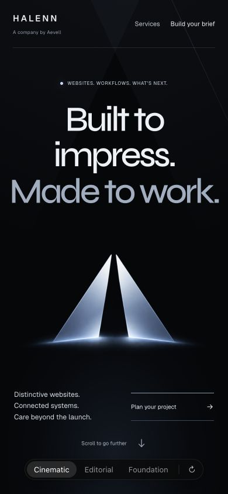
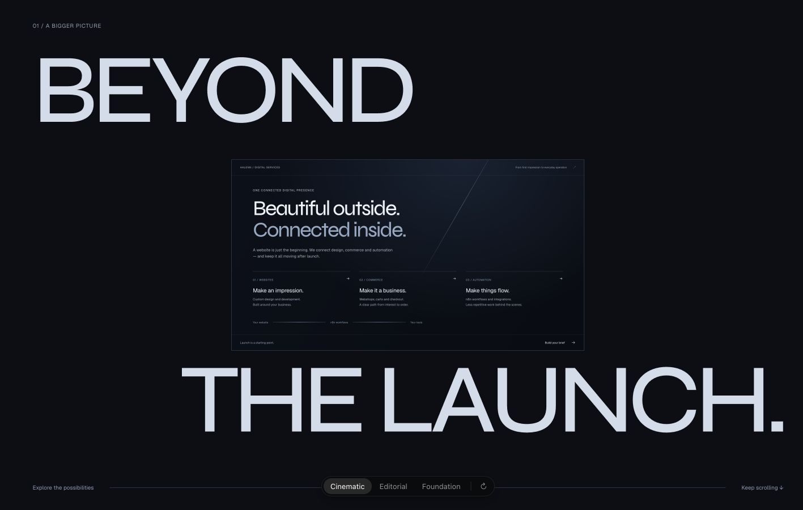
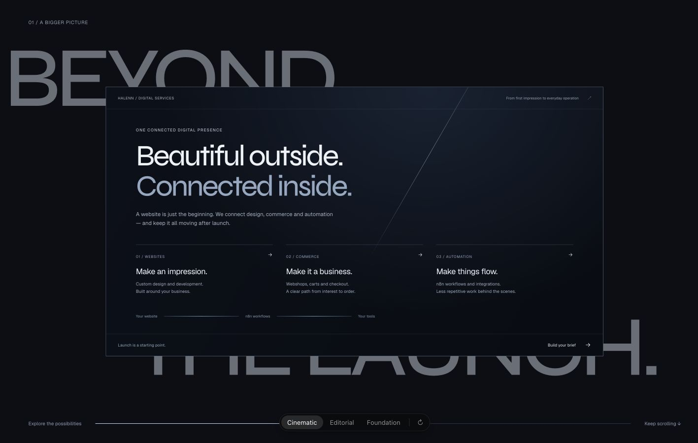
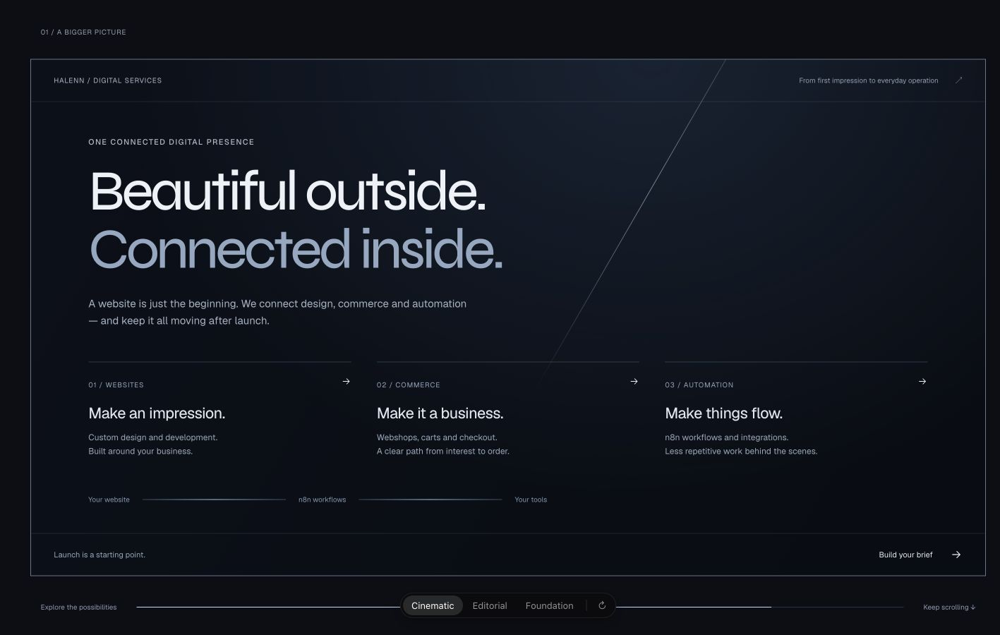

# Halenn hero explorations

Branch: `codex/halenn-hero-explorations` · original production baseline: `0f4c17251b0502e13ffbf44e106a7937ce537945` · 23 October 2026.

## Current direction: Cinematic

The owner approved a cinematic hero and expanding scroll scene after reviewing the portfolio recording. The business positioning has also changed: **Halenn offers websites, commerce, maintenance and n8n workflows. Aevell is Halenn’s parent company.** All three prototypes now reflect that relationship. The production homepage retains its original content until integration is approved.

```sh
npm ci --ignore-scripts
npm run dev -- --hostname 127.0.0.1 --port 3010
```

Open [the local picker](http://127.0.0.1:3010/prototypes/hero?v=1). Use **1–3**, **← / →**, or the picker; use **R / ↻** to replay. The URL preserves selection. Form fields are excluded from picker shortcuts. Anchor navigation into the new scene works from the comparison variants.

| # | Direction | Composition | Tradeoff |
| --- | --- | --- | --- |
| 1 | Cinematic | Screen-filling typography and original artwork, coordinated entrance, a reversible inset-to-full-size scroll scene | Strongest motion and brand presence; adds a deliberate scroll sequence |
| 2 | Editorial | Asymmetric typography with an independent artwork field | Direct and confident; less theatrical |
| 3 | Foundation | Halenn’s services alongside its relationship to Aevell | Clearest corporate relationship; less distinctive as a service-business hero |

Cinematic replaces Monument in the picker. The first-round implementation remains recoverable in commit `5df3a70`. Current changes are limited to the prototype surface, its verification script and evidence. No merge, push or production deployment has occurred.

### Restored scale and persistent cursor tracking (latest)

Removed the raster-density size ceilings at the owner's request: the original screen-filling composition now has the same scale on standard and Retina displays. At 1440px viewport width the approved PNG renders at 1094.4 CSS pixels, including on the native 2× display. Artwork bytes, geometry and material remain unchanged.

The soft source now follows the cursor across the entire viewport while the hero is visible, rather than activating only within the logo link. The glow remains illuminated at 0.78 opacity and rises continuously toward 1 as the cursor approaches the artwork's center. Leaving the logo no longer resets the source. The same stationary silhouette, broad blur and 220ms transform easing are retained; hover brightness switching is removed. A visibility observer disconnects pointer tracking offscreen. Pointer events are batched into a single animation-frame write, with cached geometry invalidated by resize/scroll. Touch and reduced motion keep a static, always-on glow; the logo remains a keyboard-accessible services link.

Verified cursor response far outside the logo, proximity opacity from 0.78 to 0.992, offscreen tracking suspension, Enter/focus transfer, 390×844 mobile layout, and the uncapped 1440px/2× desktop rendering. Fresh browser logs are clean. Build, type-check, eight HTTP/artwork/production-isolation tests and the Impeccable scan pass; lint retains the two existing production image warnings. Screenshots: `screenshots/full-scale-glow/`. No physical-device frame-rate measurements or fresh reduced-motion emulation claimed. Production remains untouched; no push, merge or deployment.

### Softer directional logo light (previous revision)

The logo's moving silhouette has been replaced with a stationary silhouette containing a broad, moving radial light source. The blur is applied outside that mask and stays constant (24px desktop, 14px phone), so movement changes the illumination rather than shifting a second sharp contour. Pointer travel is bounded to 38% horizontally and 28% vertically, with a 220ms interruptible CSS transform transition. Ambient light remains visible at rest. No global pointer listener, React state per pointer event, or continuously running animation was added. Reduced motion retains static light and immediate keyboard navigation.

The full original 1774×887 PNG was already delivered unoptimized, without filters or transforms on the visible image. Its original pixels and checksum remain unchanged. The logo link now has a rendering ceiling of 1774 CSS pixels at standard density, 887 at 2×, and 591 at 3× to avoid excessive enlargement at those densities; the surrounding composition retains its aspect-ratio field. This preserves available detail rather than inventing detail through sharpening or generative upscaling. A larger source master would be needed for genuinely higher resolution at larger physical display sizes.

Validation: visual review at 1440×900 and 390×844; pointer movement across the artwork, reset on leave, Enter navigation and focus transfer checked. The native 2× browser reports the expected 887px ceiling and the original asset URL. No horizontal mobile overflow or fresh console warnings/errors. Build, type-check, all eight HTTP/artwork/production-isolation tests and the Impeccable scan pass; lint retains the two original homepage image warnings. PNG checksum and production application files remain unchanged. Device GPU/frame-rate profiling and fresh reduced-motion emulation were not performed. Screenshots: `screenshots/soft-logo-light/`. No push, merge or deployment.

### Mobile cinema and silhouette lighting (previous revision)

Phones now receive a dedicated cinematic sequence at widths up to 600px and heights of at least 700px, without reduced motion. Native vertical scrolling advances a pinned gallery through three complete website compositions, with reading holds at each project. The process then travels through three horizontal chapters. Subtle overlapping arrivals connect services, projects, process, scope and contact; phone travel is 35% of the desktop camera displacement. No wheel/touch interception or continuous animation loop was added. Short screens, reduced motion and content that cannot fit retain the flowing layout. Geometry is cached and recalculated on resize; scroll updates use transform/opacity rather than React renders per frame.

The rectangular logo light has been replaced with an always-present silhouette glow. A separate decorative layer uses the approved PNG’s alpha to shape the light, with a static blur and bounded 9px/7px pointer translation. The visible original image is unchanged, unfiltered and untransformed; its checksum still matches the supplied file. No artwork editing or reconstruction was needed. A wider ambient ellipse fades into the surrounding background. The old outlined pill is now a quiet “Explore services” hint, separated from the main CTA. Keyboard activation still transfers focus directly to services; reduced motion disables pointer tracking.

**Validation:** build, type-check and all eight HTTP/artwork/production-isolation checks pass. Lint retains only the two original production image warnings; Impeccable's scan returned no findings. Browser inspection covered 390×844, 320×740, 390×650 fallback, and desktop 1440×900. All three compact previews fit their 370px containers at 320px, without document overflow. Verified gallery next controls, scroll-driven transitions, reverse scrolling, complete final process copy, full-size modal preview/Escape/focus restoration, contact navigation, desktop pointer response, and logo keyboard focus transfer. A fresh reload captured no application warnings/errors; earlier editing-only Fast Refresh reload notices were observed. Screenshot evidence is in `screenshots/mobile-cinema/`.

These are development-browser viewport and interaction checks, not physical-device touch/GPU profiling or measured frame-rate/Core Web Vitals results. Reduced-motion behavior and server-visible content were checked in source/server output; fresh OS preference emulation and browser zoom were not performed in this revision. Production application files remain identical to the audited baseline; prototypes return 404 in a normal production build. No push, merge or deployment.

### Continuous scroll and interactive logo (previous revision)

The cinematic prototype now connects adjacent scenes with a shared scroll timeline. The hero holds briefly behind the incoming services scene. Services recede left as the gallery arrives; the gallery recedes into the process chapters; scope leads into two contact words that assemble into the final headline. Adjacent desktop scenes overlap by 16svh, and every transformation reverses directly with native scrolling. No wheel interception, smooth-scroll dependency, or animation library was added.

The hero artwork is now a real services link. Fine-pointer movement translates a separate ambient light behind the unchanged original PNG. Hover/focus reveals “Explore the experience”; pointer activation uses native smooth scrolling to the fully expanded services frame. Enter and reduced-motion activation move immediately, transfer focus to the services landmark, and update the URL hash. Touch has a persistent affordance and the same link action. No logo rotation, recoloring, masking or image transform was introduced.

The full connecting choreography runs at widths above 1000px and heights of at least 800px with no reduced-motion preference. Phone/tablet/short-screen layouts retain flowing sections and the existing fit-checked service expansion. Reduced motion restores static composition; the logo retains gentle opacity feedback and ordinary navigation. Keyboard-focused controls are exempt from outgoing camera transforms. Transparent section overlap was corrected so it cannot intercept the outgoing gallery controls. Layout observers refresh cached positions when upstream content changes.

Validation: production build, type-check and eight HTTP/integrity/isolation tests pass. Lint has only the two existing production image warnings; the final Impeccable scan found no issues. Desktop forward/reverse handoffs, gallery previous navigation at the overlap boundary, logo pointer response/click, keyboard Enter/focus transfer, mobile full-size service arrival, 320px contact reflow and short-screen fallback were checked in the browser. Screenshot evidence is in `screenshots/continuous-flow/`. Production application files remain identical to the audited baseline. Reduced-motion media behavior was reviewed in source; fresh OS/browser media emulation and physical-device frame-rate measurements were not performed. No push, merge or deployment.

### Echo-inspired dark direction (previous revision)

The owner requested the reference video's bolder typography and scroll choreography across the rest of the prototype, and removal of the gray process section. Variant 1 now uses locally bundled Barlow Condensed at 500/600 for display type, with Geist supporting copy and the existing concept-specific typography preserved. Font files are sourced from Google Fonts; the SIL Open Font License is included beside them. A failed development font fetch was caught visually and replaced with deterministic local font files.

- A large HALENN wordmark precedes the opening panels. The hero resolves into asymmetric, screen-filling “Built to impress.” typography and the upright original artwork. The artwork itself is not animated or altered.
- Services, projects, process, scope and contact share the condensed display hierarchy, generous spacing, and rounded controls. The former light gray process surface is now near-black with cool blue accents.
- Desktop process chapters travel horizontally under a fixed heading using native scroll and transform updates. The enhancement runs only at widths above 1000px, heights of at least 800px, and without reduced motion; smaller/shorter layouts and static server output retain all three chapters in normal document flow. Resize observation refreshes geometry after layout changes.
- The contact ending is a single oversized “LET’S TALK.” line. Project preview designs and their dialog behavior are preserved.

**Verification:** type-check and production build pass. Lint has only the two pre-existing production image warnings. All eight HTTP/asset/isolation tests pass, including unchanged artwork bytes and production prototype 404s. Production page, layout, global styles, update gate and version endpoint remain identical to the audited baseline. Impeccable's mechanical scan returned no findings. Browser logs contained no captured application errors; development warnings included Fast Refresh and an LCP advisory for a lazy project image when navigating directly into the projects area. Project images remain lazy for normal hero-first entry.

Visual checks covered 1440×900, 390×844, 320×844, 768×1024, and the 1440×650 flowing fallback. A tablet headline/artwork overlap was corrected. Inspected opening, service expansion, project ribbon, forward/reverse process travel, scope disclosure, contact navigation and native dialog Escape/focus restoration. Narrow document width matches the viewport. Reduced-motion behavior and server-visible content were reviewed in code/HTTP output; this pass does not claim new browser motion emulation, physical-device touch/GPU profiling, zoom tests or measured Core Web Vitals.

Evidence: `screenshots/echo-direction/` contains desktop/mobile heroes, expanded desktop services, desktop/mobile process and desktop/mobile contact. This revision stays on the prototype route; no push, merge or deployment.

### Project and typography refinement (previous revision)

The latest owner feedback asked for more convincing premium website previews, calmer typography, rounded integrated controls, and less small-text clutter. Variant 1 now uses Geist for Halenn’s headings and body, mostly 400-weight headings, tracking no tighter than −0.04em, 16–18px supporting copy, and 14–15px secondary information. Redundant labels and duplicated service headings were removed. Main actions, dialog close buttons and inputs share rounded shapes; the picker remains its prescribed comparison chrome.

FORMA now has an architectural photo-led composition, OBJECT a furniture collection layout, and CONNECTED an automation landing page with a workflow workspace. Instrument Serif is self-hosted through `next/font` for the two editorial concepts only. The architecture and furniture photographs are AI-generated concept assets stored in `public/prototypes/projects/`; they represent fictional work, not clients or built projects. `next/image` provides responsive optimized image delivery. The supplied Halenn logo remains the exact original PNG. The mini-site navigation/actions are part of a static visual study; clicking the overall project opens its accessible preview, rather than pretending these are deployed client sites.

Controls retain their interactions. Larger service copy caused the mobile expanding frame to exceed its viewport during refinement; the copy hierarchy was simplified and pinning now also checks whether the frame fits. At insufficient height it uses readable flowing content. No animation dependency was added.

Validation: build and type-check pass; lint retains only two original production image warnings; all eight HTTP/artwork/production-isolation checks pass. Reviewed the new projects at desktop 1440×900, phone 390×844, and the narrow workflow at 320×844. Checked project navigation, preview opening/Escape dismissal, replay, keyboard-triggered service expansion, contact navigation and the redesigned form. No horizontal document overflow at 320px; no failed loaded images or captured browser errors. Impeccable’s final mechanical scan returned no findings. This pass does not claim new physical-device, zoom, reduced-motion-emulation or frame-rate measurements.

Updated visual evidence is in `screenshots/refined/`. Production page/layout/global CSS/deployment gate/version endpoint still have no diff against the audited baseline. No push, merge or deployment.

### Full experience revision

The owner approved extending the cinematic route with projects, process, service options and a large contact ending, and requested a stronger opening. This revision remains isolated to variant 1.

- **Opening:** a silver-blue seam opens into two receding panels over 1.8 seconds. The surrounding light resolves and the headline composition settles as a whole; the earlier line-by-line reveal is removed. Navigation remains available. The original artwork stays still and unchanged. Reduced motion removes the aperture and composition entrance.
- **Projects:** three clearly labelled fictional concepts (FORMA architecture, OBJECT commerce, CONNECTED automation) have designed interface previews and modal close-ups. On large, tall screens, native vertical scrolling moves a perspective ribbon; dragging and previous/next buttons also work. Smaller screens use a native horizontal carousel. Reduced motion removes the perspective/pinning enhancement.
- **Process:** three large stacked chapters explain discovery, build and ongoing care. Mobile uses ordinary flowing sections.
- **Scope and contact:** native disclosure controls expose optional services. Selections feed both the existing text brief and a local enquiry demo. The ending uses oversized LET’S TALK typography. The form validates required fields but sends nothing; its reserved `.example` contact address is explicitly labelled as a placeholder.
- **Accessibility:** project and enquiry previews use native modal dialogs with Escape dismissal and focus restoration. Picker shortcuts ignore dialogs, service disclosures and local project controls. Sections remain server-rendered and readable before hydration.

**Verification for this revision:** build and type-check pass; lint has only the two existing production image warnings. All eight HTTP/artwork/production-isolation tests pass. Existing production page, layout, CSS, deployment gate and version endpoint have no diff against the original baseline. Desktop project arrows, dragging, project preview, Escape/focus restoration, service selection, scope transfer and local form submission were exercised. Mobile project arrows and preview were exercised at 390px, with an additional 320px workflow-layout correction. 768px and 1440×650 layouts use the unpinned fallback; no document overflow was found at 320, 390, 768 or 1440px. Opening replay was observed. Browser logs contained development Fast Refresh reload notices and no captured application errors.

Screenshots are in `screenshots/full-experience/`: hero, projects and process desktop views; contact desktop/mobile; projects mobile; workflow at 320px. These are development observations, not measured Core Web Vitals or frame-rate results. Real-device touch/GPU performance, fresh reduced-motion emulation, disabled-JavaScript browser operation and browser zoom were not re-run in this revision; reduced-motion and static rendering were checked in source/server output. Placeholder project screens do not imply existing clients or delivered results.

### Previous cinematic revision (historical)

The following details and screenshots describe the preceding hero/expanding-scene revision. Its masked entrance has now been replaced by the aperture opening above.

- A 1,150ms masked headline entrance, with a 70ms stagger; surrounding light resolves over 1,500–1,600ms. The approved logo stays upright and still. No filters, masks, recolouring, reconstruction or cropping are applied to the artwork.
- Native scrolling moves into “Beyond the launch.” A sticky scene expands its service frame from 46% to full size. Background typography recedes; reverse scrolling reverses the transformation. The expansion finishes before unpinning so the content can be read at full size.
- The frame explains custom websites, commerce and n8n automation. A compact project planner offers webshops, cart/checkout, workflows, monthly website care, bookings/forms, and CMS/technical SEO. No clients, results, price amounts or delivery promises are fabricated.
- Selected services produce a real local text-file download. This is a project brief, not an enquiry submission; there is no external form endpoint, payment flow or invented contact address.
- Server markup is passed through small client boundaries. Content is visible by default. The sticky/zoom sequence is enabled only after hydration, and is removed for reduced motion, short viewports and the tablet/reflow range.
- A focus entering the small frame brings it to full size instantly. Hover motion is fine-pointer gated. Native anchors work without the old global smooth-scroll delay; the override is conditional on the cinematic component being present.

### Current screenshots

| Desktop hero | Mobile hero |
| --- | --- |
|  |  |

| Inset scene | Expanding scene | Expanded scene |
| --- | --- | --- |
|  |  |  |

Also captured: expanded phone scene, 320px hero, tablet services, keyboard focus, project brief selection, and refreshed Editorial/Foundation desktop and phone views in `screenshots/cinematic/`.

### Current verification

**Story:** enter the local prototype → watch the opening → scroll forward/back through the expanding scene → select services → download the matching brief. No backend integration is part of this prototype.

| Boundary | Evidence |
| --- | --- |
| Build and static analysis | `npm run build` and `npm run typecheck` pass. Lint has zero errors and only the two existing image warnings in untouched production components. |
| Development HTTP / server content | All six variant/invalid-query cases pass. Each response has one h1, noindex metadata, Aevell positioning and n8n content without requiring JavaScript to render it. |
| Artwork | Served bytes match the supplied 1774×887 PNG SHA-256 `8d0753ae6b55e250a7880408943cbfb80e9a37d041b1274900140d68d9f94c97`. |
| Production isolation | Local `next start`: homepage 200, version API 200, all three prototype URLs 404. Original production app files have no diff against the audited baseline. |
| Browser geometry | 1440×900, 390×844, 320×844, 768×1024 and 1440×650 inspected. No horizontal overflow in these views. Tablet and short-screen layouts use unpinned content. |
| Reversible motion | Desktop frame width measured 622.66px → 1010.43px → 816.55px when reversing → 1353.61px fully expanded. Phone full-size frame is 358×709.47px within 390×844. |
| Keyboard | Number/arrow selection, URL reload, replay, visible focus, and focus-triggered full expansion checked. |
| Brief | Four options selected through phone-size controls. Downloaded file contains Webshop, Cart & checkout, n8n workflows and Website care, with project/monthly pricing models and no invented amount. |
| Console | No captured warnings or errors in the final development browser session. |

Browser measurements are saved in `cinematic-checks.json`. These are development-layout and interaction observations, **not a measured frame-rate, CLS or Lighthouse benchmark**. Scroll writes are limited to transform/opacity, with geometry cached on resize, a passive scroll listener and no React state updates per frame. Gradients are static; there is no perpetual animation or animated blur. Actual phone hardware/GPU performance remains unmeasured.

Reduced-motion handling and the no-JavaScript static layout were verified from source and server output in this round. A separate Chrome QA tab could not open native DevTools emulation, so a fresh browser emulation of reduced motion, disabled JavaScript and actual browser zoom is not claimed. The historical first-round checks below apply only to that round. No browser settings were changed.

**Motion verdict: approve for prototype design review.** Marketing entrances provide delight; the scroll transformation provides spatial continuity and explanation. Production integration and device performance acceptance remain separate steps.

| Before | After | Why |
| --- | --- | --- |
| Quiet centered Monument hero | Larger coordinated headline and surrounding light, followed by an expanding scene | Restore the original’s scale and implement the approved reference-inspired motion |
| Parent-company positioning for Halenn | Halenn services, Aevell parent relationship across all variants | Reflect the owner’s new business structure |
| Small scene links could receive keyboard focus | Focus instantly expands the frame | Keep keyboard navigation legible |
| Floated legend displaced the first mobile option | Normal fieldset legend flow | Keep every option aligned and usable |
| Inherited smooth scrolling interfered with rapid anchor interaction | Prototype-conditional native anchor jumps | Preserve direct navigation without changing production globals |

The following audit and verification describe the **first exploration round**, before the positioning change and cinematic revision. Existing screenshot filenames outside `screenshots/cinematic/` are historical evidence.

## First-round audit (historical)

The connected GitHub repository and live deployment were inspected before edits. `/api/version` identified the same audited commit. The current workspace was an empty, unrelated Aevell repository; a separate Halenn checkout was created without changing it.

| Before | After in this exploration | Why |
| --- | --- | --- |
| `app/halennLogo.ts:1` embeds a 192×96 WebP; direct decoding and the live hero both show block/color artifacts. | All prototype logo instances reference the supplied original PNG through an unoptimized image component. | Avoid enlarging damaged artwork or re-creating the mark. |
| Several competing sources exist: two data-URI modules, a raster-in-SVG wrapper, and three WebPs. The cinematic WebP contains 7,512 bytes while its RIFF header declares 21,364. | One verified original source for all prototypes. Existing assets remain untouched for comparison. | A name such as “approved” cannot establish file integrity. |
| `app/globals.css:241` overlays another brightened, masked copy of the mark; multiple blurred layers breathe indefinitely. | No filters or masks on the artwork. Monument uses one bounded opacity entrance on the surrounding light. | Preserve the approved material and remove unnecessary continuous work. |
| `app/page.tsx:1` makes the whole landing page a client component. `:81` tracks every pointer movement even when the light is off. | Server-rendered variant markup is passed into a small client picker. No pointer tracking or motion dependency. | Keep static content independent of decorative behavior. |
| `app/page.tsx:150` and `:160` lock flashlight transitions for 1,550/1,250ms. Touch CSS hides the visuals while the control remains active. | No flashlight state machine. Picker selection is immediate. | Remove a delayed interaction with no meaningful touch result. |
| Reduced-motion CSS shortens animations but does not shorten those JavaScript timers. | Reduced motion removes the text transform and environmental entrance; content remains fully visible. | Visual and interaction state no longer drift. |
| `app/globals.css:1038` starts revealed content at opacity zero. | Prototype content is server-rendered and visible without JavaScript. | Avoid invisible content on script/observer failure. |
| `app/DeploymentUpdateGate.tsx:149` blocks the page with a modal lacking focus management and dismissal. | No deployment messaging can appear on the development-only route; the inherited component is left intact on the reference homepage. | Avoid editing production behavior before a direction is selected. |
| Small, tracked Michroma labels and three font families compete with the hero. | Geist-led Monument/Editorial; Syne gives Foundation a different typographic voice. No additional fonts. | Explore hierarchy without adding font downloads. |
| The 390px reference hero is about 909px tall, with a four-line headline. Principles disappears from mobile navigation; its sibling links are only 18px high. | All destinations remain present with 44px-high targets. Each design has its own mobile composition. | Preserve function while exploring layout. |
| Hero footer text is approximately 3.41:1 against the base background. Hover animates padding/width and includes transitions up to 900ms. | Higher-contrast text, fine-pointer hover gating, short explicit transitions. | Improve legibility and avoid needless layout work. |
| No dependency lockfile or repeatable verification command. | npm lockfile, type-check script, and eight HTTP/integrity checks. | Make the checkout and basic verification reproducible. |
| Baseline Next 16.4.0 compiled but the build stopped on a critical advisory. | Next and eslint-config-next patched to 16.4.3; production build passes. | Address the concrete framework issue on this isolated branch. |

**Baseline checks:** lint passed with two existing image warnings; TypeScript passed. The initial build compiled/prerendered and then exited with the framework security advisory. The patched build succeeds; `npm audit --omit=dev` reports zero runtime vulnerabilities. Five high npm audit findings remain in the development-only ESLint → fast-glob → micromatch → braces dependency chain. npm's suggested forced remediation would downgrade the lint framework; it was not applied.

The linked Aevell domain currently resolves to a GoDaddy parked page. The owner confirmed that `aevell.com` is their domain, so the inherited target is deliberately retained.

## Artwork provenance

Original supplied file: `ChatGPT Image Oct 8, 2026, 03_21_35 PM.png`.

- Exact copy: `public/prototypes/halenn-original.png`.
- Dimensions: **1774 × 887**; PNG with alpha; **807,851 bytes**.
- SHA-256: `8d0753ae6b55e250a7880408943cbfb80e9a37d041b1274900140d68d9f94c97`.
- Both the copied file and HTTP-served bytes match this checksum.
- No lossy optimization, cropping, masking, recoloring, generation, or geometry edits. Intrinsic dimensions reserve layout space. Header and hero instances share one asset URL.

## First-round verification (historical)

```sh
npm run lint
npm run typecheck
npm run build
npm run start -- --hostname 127.0.0.1 --port 3011
# With the dev server also running:
HALENN_PRODUCTION_URL=http://127.0.0.1:3011 npm run verify:hero
```

- **Eight automated tests pass:** each direction's server-rendered selection, malformed/out-of-range/repeated query fallback, one real H1, noindex metadata, navigation destinations, original image bytes/dimensions, production 404s, homepage and version endpoint availability.
- **Browser:** every direction inspected at 1440×900 and 390×844; additional 320×740, 768×1024, and 1280×720 checks. No horizontal overflow; one active picker item and one H1. Raw layout evidence is in `browser-checks.json`.
- **Interactions:** picker clicks, number keys, arrow wraparound, replay, reload persistence, internal navigation, skip-link focus transfer, and Aevell's new-tab link. All internal navigation targets resolve to the preserved homepage sections.
- **Accessibility:** visible keyboard focus, 44px product navigation/actions, semantic landmarks, decorative logo alt handling, contrast (minimum measured static text ratio 6.73:1), narrow-viewport reflow, and actual 200% Chrome zoom for all three variants without horizontal overflow. Picker chrome is the skill's prescribed 28px control height. It fits at 320px.
- **No JavaScript:** verified in Chrome with DevTools' JavaScript blocking enabled for all three direct URLs; all headings and images remain visible. The picker requires JavaScript, while the navigation remains ordinary links.
- **Reduced motion:** Chrome's media emulation verified `animation-name: none`, `transform: none`, and `opacity: 1` on Editorial's animated text. Browser settings were restored afterward.
- **Console:** no application warnings/errors captured during the final normal browser flow. The two existing source lint warnings remain confined to production image components. An editing-only Fast Refresh hook warning was cleared with a fresh document. The legacy smooth-scroll router warning is avoided by using document links for reference destinations.
- **Preservation:** existing tracked application/public files have no diff against the audited commit. Shared configuration changes are the security patch, npm lock, verification scripts, Next's generated dev-types include, and hiding the local development badge.

### Performance interpretation

These are development-only prototypes, not production benchmarks. They use server markup and one client harness; no global pointer listener, continuous animation, blur animation, or added motion library. Artwork dimensions reserve the correct aspect ratio and all image instances loaded at their original resolution. The exact original PNG is intentionally 807KB rather than a lossy substitute.

The original page's large filtered layers and always-on pointer work are code-confirmed risks, not measured frame-rate failures. Chrome's page-load trace stalled waiting for a load event and was stopped; no LCP or frame-rate score is claimed. A physical-device GPU/gesture profile and production Core Web Vitals for the eventual selected implementation remain future checks. Actual 200% browser zoom was checked in Chrome and restored afterward. Narrow reflow was verified down to 320 CSS pixels.

**Motion review: approve these isolated prototypes; block reuse of the current production effects unchanged.** The prototypes use the existing scoped easing token with Emil's `cubic-bezier(0.23, 1, 0.32, 1)`, 160ms interaction transitions, 240ms text entry with 40ms stagger, and one 650ms atmospheric entrance. Only the skill-prescribed small picker highlight animates width. No mark is transformed. Integration and the rest of the site wait for the owner's choice.

## Skill sources

- [Design engineering](https://github.com/emilkowalski/skills/blob/main/skills/emil-design-eng/SKILL.md)
- [Prototype and picker contract](https://github.com/emilkowalski/skills/blob/main/skills/prototype/SKILL.md)
- [Animation construction](https://github.com/emilkowalski/skills/blob/main/skills/animate/SKILL.md)
- [Animation review](https://github.com/emilkowalski/skills/blob/main/skills/review-animations/SKILL.md)
- [Animation performance](https://github.com/emilkowalski/skills/blob/main/skills/animation-performance/SKILL.md)
